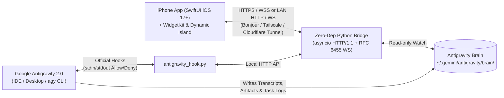

# Antigravity Monitor (`native_agy_ios`)

> **100% Free, Open-Source, Self-Hosted Native SwiftUI iOS 17+ Remote Monitor & Tool-Approval Companion for Google Antigravity 2.0.**

[](LICENSE)
[](ios/project.yml)
[](ios/Packages/AntigravityCore/Package.swift)
[](bridge/pyproject.toml)

---

## Why This Project Exists

Google does **not** ship an official native iOS app on the App Store for Antigravity — iOS users only get the Safari web PWA at `antigravity.google`, while existing open-source repos target web dashboards or Android/Flutter, and third-party App Store apps are closed-source, ad-supported, subscription-gated, or route traffic through proprietary cloud relays.

**Antigravity Monitor** gives iOS users a genuinely native, privacy-first alternative:

- **100% Free & MIT Open-Source** — zero subscriptions, zero ads, zero third-party relays, zero telemetry.
- **Native SwiftUI iOS 17+ Experience** — Dynamic Island & Lock Screen **Live Activities** (`ActivityKit`), **Home Screen Widgets** (`WidgetKit`), iOS Keychain token storage, native camera QR pairing (`agymon://pair?...`), Bonjour LAN discovery (`_antigravity-mon._tcp`), and actionable approval notifications.
- **Interactive Remote `PreToolUse` Tool Gating** — approve or deny gated tool executions (like `run_command`) straight from your iPhone using **Official Antigravity Hooks**.
- **Zero-Dependency Companion Bridge** — pure Python 3.10+ standard library (`asyncio` HTTP/1.1 + RFC 6455 WebSocket server + pure-Python terminal QR renderer). No `pip install`, Node.js, or Docker required.
- **Strictly Sanctioned Interfaces Only** — reads Antigravity 2.0's documented `~/.gemini/antigravity/brain/<conversation-id>/` transcripts/artifacts/task logs and integrates via official `~/.gemini/config/hooks.json` / `.agents/hooks.json` hooks.

See [Existing Apps & Ecosystem Research](docs/EXISTING_APPS_RESEARCH.md) for the full landscape analysis.

---

## Architecture at a Glance



For the complete wire protocol, event envelopes, and security model, see [Architecture & Wire Protocol (v1.0)](docs/ARCHITECTURE.md).

---

## Key Features

### Native iOS App (`ios/`)
- **Live Sessions Dashboard**: Real-time session list with search, status filters (All / Active / Errors), pulsing running indicators, token & cache hit-rate summaries, and subagent / swarm badges.
- **Rich Session Inspector**: Segmented detail view for **Transcript** (collapsible Thinking blocks, expandable monospaced Tool Call JSON, Markdown rendering, authenticated media images), **Artifacts** (plans, reports, images), and **Tasks & Swarms** (scrollable background task logs, subagent invocations, swarm event timeline).
- **Remote Tool Approval Queue**: Live countdown timers (`TimelineView`), highlighted tool names & JSON arguments, haptic **Allow / Deny** buttons with optional denial reasons, plus actionable iOS notification buttons (`ALLOW_ACTION` / `DENY_ACTION`).
- **Dynamic Island & Widgets**: Lock Screen & Dynamic Island Live Activities (`AntigravityMonitorWidgets`) showing active session status, model, step count, and pending approval badge, plus Small & Medium Home Screen status widgets.
- **3-Way Pairing & Multi-Host Telemetry**: Camera QR scanner (`agymon://pair?...`), Bonjour LAN auto-discovery (`_antigravity-mon._tcp`), manual URL + token entry, multi-workstation switching, and built-in **Demo Mode** when no host is paired.

### Companion Bridge (`bridge/`)
- **Pure Python 3.10+ Stdlib**: Zero external dependencies required at runtime; optional `zeroconf` extra for Bonjour LAN advertising.
- **Full v1 REST & RFC 6455 WebSocket API**:
  - `GET /api/v1/ping` (unauthenticated liveness check)
  - `GET /api/v1/health` (host telemetry & cumulative token counters)
  - `GET /api/v1/sessions`
  - `GET /api/v1/sessions/{id}/transcript`
  - `GET /api/v1/sessions/{id}/artifacts` & `/artifacts/{path}`
  - `GET /api/v1/sessions/{id}/tasks`
  - `GET /api/v1/sessions/{id}/media/{filename}`
  - `GET /api/v1/approvals`, `POST /api/v1/approvals/request`, `POST /api/v1/approvals/{id}/decide`
  - `POST /api/v1/hooks/event`
  - `GET /api/v1/ws` (real-time event streaming with heartbeat ping/pong)
- **Built-in Terminal QR Code Pairing & Hook Installer**: `serve`, `pair-qr`, `install-hooks`, and `status` CLI subcommands.

---

## Quickstart

### 1. Start the Bridge on Your Workstation

**Windows (PowerShell):**
```powershell
git clone https://github.com/npolarski1/native_agy_ios.git
cd native_agy_ios
$env:PYTHONPATH = "bridge"
python -m antigravity_bridge serve
```

**macOS / Linux:**
```bash
git clone https://github.com/npolarski1/native_agy_ios.git
cd native_agy_ios
PYTHONPATH=bridge python3 -m antigravity_bridge serve
```

### 2. Install Official Antigravity Hooks (Optional — Enables Instant Notifications & Remote Approvals)

```bash
# Windows (PowerShell): $env:PYTHONPATH="bridge"; python -m antigravity_bridge install-hooks
PYTHONPATH=bridge python3 -m antigravity_bridge install-hooks
```

### 3. Build the Native iOS App (macOS + Xcode 16+)

```bash
brew install xcodegen
cd ios
xcodegen generate
open AntigravityMonitor.xcodeproj
```

Select the **AntigravityMonitor** scheme, choose an iOS 17+ Simulator or your connected iPhone (with your Apple signing team selected), and press **Cmd + R**.

### 4. Pair Your iPhone

Scan the QR code printed by `serve` (or run `python -m antigravity_bridge pair-qr`) inside the app's **Pair Host** sheet. For off-LAN remote monitoring, pair over **Tailscale** or **Cloudflare Tunnel** — see the complete [Setup Guide](docs/SETUP_GUIDE.md).

---

## Running Tests & CI

Every push and pull request runs automated verification in [`.github/workflows/ci.yml`](.github/workflows/ci.yml):

| Job | Runner | Command |
| --- | --- | --- |
| **Bridge Tests** | Ubuntu, Windows, macOS (Python 3.12) | `PYTHONPATH=bridge python -m unittest discover -s bridge/tests -v` |
| **iOS Core Tests** | macOS 15 (SwiftPM) | `swift test --package-path ios/Packages/AntigravityCore` |
| **iOS App & Widget Build** | macOS 15 (Xcode 16 + XcodeGen) | `xcodegen generate && xcodebuild -project AntigravityMonitor.xcodeproj -scheme AntigravityMonitor -destination 'generic/platform=iOS Simulator' CODE_SIGNING_ALLOWED=NO build` |

---

## Documentation

- [Setup Guide](docs/SETUP_GUIDE.md) — Windows/macOS/Linux bridge setup, Xcode build, hooks, Tailscale & Cloudflare Tunnel
- [Architecture & Wire Protocol (v1.0)](docs/ARCHITECTURE.md) — System diagrams, approval flow, REST & WebSocket contract
- [Existing Apps & Ecosystem Research](docs/EXISTING_APPS_RESEARCH.md) — Official Google status, GitHub OSS ecosystem, and App Store audit

---

## License

Licensed under the [MIT License](LICENSE) — Copyright (c) 2026 npolarski1.
