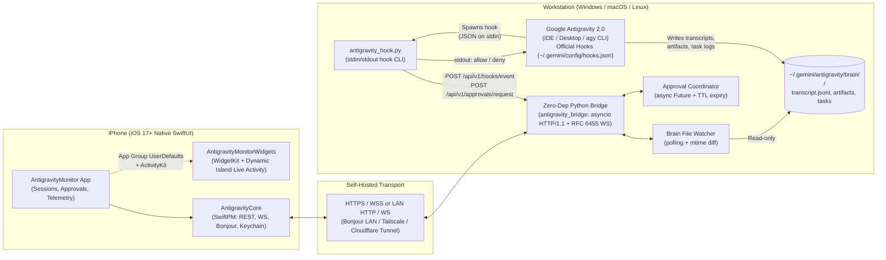
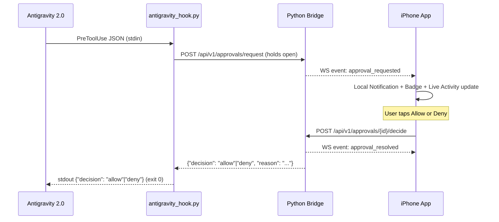

# Architecture & Wire Protocol (v1.0)

**Antigravity Monitor** connects a native SwiftUI iOS 17+ client to your workstation running Google Antigravity 2.0 through a lightweight, zero-dependency Python companion bridge. Everything stays on your local network or your own encrypted tunnel (Tailscale / Cloudflare Tunnel) — no third-party cloud relay is ever involved.

---

## System Overview



---

## Interactive `PreToolUse` Remote Approval Flow

When Antigravity invokes a gated tool (such as `run_command`), Official Antigravity Hooks let you approve or deny the call directly from your iPhone before execution proceeds:



The hook always exits `0` so Antigravity never hangs indefinitely, with separate configurable fallback decisions for timeouts and an offline bridge:

- **Approval timeout**: Controlled by `--timeout-decision` / `ANTIGRAVITY_BRIDGE_TIMEOUT_DECISION` (defaults to **`deny`** so unanswered remote prompts fail closed).
- **Bridge offline / unreachable**: Controlled by `--offline-decision` / `ANTIGRAVITY_BRIDGE_OFFLINE_DECISION` (defaults to **`allow`** so stopping the bridge does not block local workstation work; set to `deny` if you prefer strict fail-closed gating).

---

## Sanctioned Antigravity 2.0 Interfaces

Antigravity Monitor intentionally relies **only** on documented, sanctioned Antigravity 2.0 surfaces:

1. **Brain Directory (`~/.gemini/antigravity/brain/<conversation-id>/`)**
   - `.system_generated/logs/transcript.jsonl` — compact JSONL step log (`step_index`, `source`, `type`, `status`, `created_at`, `model`, `input_tokens`, `cache_read_tokens`, `output_tokens`, `content`, `thinking`, `tool_calls`, `media`, `truncated_fields`).
   - `.system_generated/logs/transcript_full.jsonl` — full untruncated step payloads referenced when `truncated_fields` is non-empty.
   - `.system_generated/tasks/*.log` — background task logs.
   - Top-level conversation files (excluding `.system_generated/` and `scratch/`) — Markdown plans, reports, and image artifacts.
2. **Official Antigravity Hooks (`~/.gemini/config/hooks.json` or `.agents/hooks.json`)**
   - Lifecycle hooks (`PreInvocation`, `PostInvocation`, `Stop`) use a flat array of `{"type": "command", "command": "...", "timeout": 30}`.
   - Tool hooks (`PreToolUse`, `PostToolUse`) use matcher entries `{"matcher": "<tool>", "hooks": [{"type": "command", "command": "...", "timeout": 60}]}`.
   - Hook scripts receive JSON on `stdin`, exit `0`, and `PreToolUse` writes `{"decision": "allow"}` or `{"decision": "deny", "reason": "..."}` to `stdout`.

---

## Security & Pairing Model

- **Bearer Token Authentication**: On first launch (unless supplied via `--token` or `ANTIGRAVITY_BRIDGE_TOKEN`), the bridge generates a cryptographically random URL-safe secret (`secrets`) and verifies every request using constant-time comparison (`hmac.compare_digest`).
- **Authenticated Surface**: Every `/api/v1/*` route requires `Authorization: Bearer <token>` **except** `GET /api/v1/ping` (lightweight liveness probe). WebSocket `GET /api/v1/ws` accepts either `Authorization: Bearer <token>` or `?token=<token>`.
- **iOS Keychain Storage**: The iOS app stores bearer tokens exclusively in the iOS Keychain (`KeychainTokenStore`) while non-sensitive host profiles live in `UserDefaults` / App Group storage.
- **Path Traversal Protection**: All artifact and media download endpoints validate and canonicalize target paths against the session directory, rejecting `..`, absolute paths, and symlinks escaping the conversation folder.
- **QR Code Deep-Link Pairing**:
  ```text
  agymon://pair?url=<percent-encoded-base-url>&token=<token>&name=<percent-encoded-host-name>
  ```
- **Bonjour Local Discovery**: Optional `_antigravity-mon._tcp` service advertisement in domain `local.` so iPhones on the same LAN discover workstations automatically.
- **Remote Transport**: For off-LAN access, bind the bridge to localhost/Tailscale and expose it through **Tailscale** (private WireGuard mesh) or a **Cloudflare Tunnel** (TLS-terminated HTTPS/WSS) rather than opening unencrypted ports directly on the public internet.

---

## Frozen v1.0 Wire Contract

All timestamps are **ISO-8601 UTC** strings ending in `Z` (e.g., `2026-11-20T20:35:00Z`).

### REST Endpoints

| Method & Path | Auth | Query / Body | Response Summary |
| --- | :---: | --- | --- |
| `GET /api/v1/ping` | No | — | `{"ok": true, "api_version": "1.0"}` |
| `GET /api/v1/health` | Bearer | — | `HostHealth`: `status`, `api_version`, `hostname`, `platform`, `uptime_seconds`, `brain_dir`, `brain_dir_exists`, `session_count`, `active_session_count`, `pending_approval_count`, `total_input_tokens`, `total_cache_read_tokens`, `total_output_tokens`, `server_time` |
| `GET /api/v1/sessions` | Bearer | `?limit=50` | `{"sessions": [SessionSummary]}` (`id`, `title`, `status`, `created_at`, `updated_at`, `step_count`, `model`, `input_tokens`, `cache_read_tokens`, `output_tokens`, `artifact_count`, `task_count`, `subagent_count`, `has_swarm`, `last_step_preview`) |
| `GET /api/v1/sessions/{id}/transcript` | Bearer | `?since_step=0&limit=200&full=false` | `{"session_id", "total_steps", "steps": [TranscriptStep]}` (`step_index`, `source`, `type`, `status`, `created_at`, `model`, token counts, `content`, `thinking`, `tool_calls`, `media`, `truncated_fields`) |
| `GET /api/v1/sessions/{id}/artifacts` | Bearer | — | `{"session_id", "artifacts": [ArtifactItem]}` (`name`, `relative_path`, `mime_type`, `size_bytes`, `updated_at`, `is_image`) |
| `GET /api/v1/sessions/{id}/artifacts/{path}` | Bearer | `?format=json` (optional) | Raw artifact bytes with `Content-Type`, or JSON `{"name", "relative_path", "mime_type", "content"}` when `?format=json` |
| `GET /api/v1/sessions/{id}/tasks` | Bearer | — | `{"session_id", "tasks": [TaskLogItem], "subagents": [SubagentInvocation], "swarm_events": [SwarmEventItem]}` |
| `GET /api/v1/sessions/{id}/media/{filename}` | Bearer | — | Raw authenticated media bytes (path-traversal protected) |
| `GET /api/v1/approvals` | Bearer | — | `{"approvals": [ApprovalRequest]}` (`id`, `session_id`, `hook_event`, `tool_name`, `args_json`, `summary`, `status`, `created_at`, `expires_at`, `decision`, `decision_reason`, `decided_at`) |
| `POST /api/v1/approvals/request` | Bearer | `{"session_id", "hook_event", "tool_name", "args", "summary", "timeout_seconds", "default_decision"}` | Long-polls until decided or expired; returns `{"id", "decision", "reason", "status"}` |
| `POST /api/v1/approvals/{id}/decide` | Bearer | `{"decision": "allow"\|"deny", "reason": str\|null}` | Updated `ApprovalRequest` (`404` if unknown, `409` if already resolved) |
| `POST /api/v1/hooks/event` | Bearer | `{"event", "session_id", "tool_name", "summary", "payload"}` | Broadcasts `hook_event` over WebSocket; returns `{"ok": true}` |

### WebSocket Stream (`GET /api/v1/ws`)

- Pure RFC 6455 WebSocket implementation supporting handshake, text frames, ping/pong, close frames, masked client frames, and 16-bit/64-bit extended payload lengths.
- Authenticate via `Authorization: Bearer <token>` header or `?token=<token>` query parameter.
- **Client → Server heartbeat**: `{"type": "ping"}` → bridge replies `{"type": "pong", "timestamp": "<iso_utc>"}`.
- **Server → Client JSON envelope (`BridgeEvent`)**:

```json
{
  "type": "hello | session_updated | step_added | approval_requested | approval_resolved | hook_event | health_tick | pong",
  "timestamp": "2026-11-20T20:35:00Z",
  "session_id": "optional-session-uuid",
  "session": null,
  "step": null,
  "approval": null,
  "hook_event_name": null,
  "message": null,
  "health": null
}
```

---

## Repository Module Layout

```text
native_agy_ios/
├── bridge/                                # Zero-dependency Python 3.10+ companion bridge
│   ├── pyproject.toml                     # CLI entry point: antigravity-bridge
│   ├── antigravity_bridge/                # asyncio HTTP/1.1 + WS server, brain watcher, approvals, QR, Bonjour
│   ├── hooks/                             # Official Antigravity hook script & hooks.example.json
│   └── tests/                             # unittest unit + loopback E2E test suite
├── ios/                                   # Native Swift 5.10 / SwiftUI iOS 17+ project
│   ├── project.yml                        # XcodeGen specification (App + WidgetExtension + Core)
│   ├── Packages/AntigravityCore/          # Cross-platform SwiftPM core library + XCTest suite
│   ├── AntigravityMonitor/                # SwiftUI iOS app (Sessions, Approvals, Pairing, Telemetry, Settings)
│   └── AntigravityMonitorWidgets/         # WidgetKit Home Screen widgets & ActivityKit Live Activities
├── docs/                                  # Research, architecture, and setup documentation
└── .github/workflows/ci.yml               # Cross-OS Python tests + macOS SwiftPM & Xcode CI builds
```
